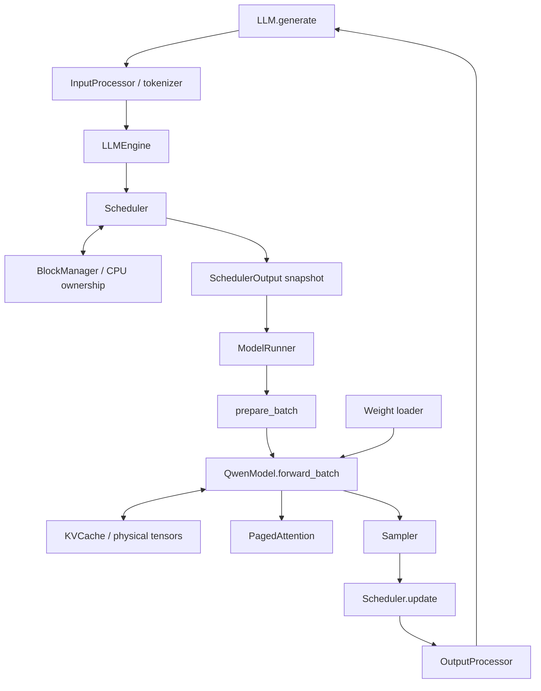

# 从 BlockManager 到完整 MicroInfer

目标是一个**单进程、单卡、文本、自回归、decoder-only Qwen3** 推理引擎：
支持多请求、连续批处理、chunked prefill、prefix cache、分页 KV、逐 token decode、
EOS/长度停止及请求取消。先实现可在 CPU 上验证的正确版本，再接 GPU 算子。

本次提供的是开发任务、共享数据结构、接口骨架和可执行验收测试。
`NotImplementedError("Mxx: ...")` 是待实现位置，不代表引擎已经能够推理。
你完成的 BlockManager 不改算法；其 30 项测试和 Sequence 的 10 项测试已通过，
对应已解决的 `known_bug` 标记已删除，断言保留。

## vLLM 参考与 MicroInfer 的取舍

职责边界参考官方 [vLLM V1 架构说明](https://docs.vllm.ai/en/v0.19.0/design/arch_overview/)：
Engine Core 协调调度与执行，Worker/ModelRunner 负责模型执行；前后处理属于输入输出边界。
MicroInfer 第一版把这些职责保留为普通 Python 对象，不引入进程通信。

调度结果与执行器解耦参考 [SchedulerOutput](https://github.com/vllm-project/vllm/blob/main/vllm/v1/core/sched/output.py)，
迭代顺序参考 [EngineCore.step](https://github.com/vllm-project/vllm/blob/main/vllm/v1/engine/core.py)。
这里的字段是适配现有 Sequence 的精简设计，不是 vLLM API 的兼容实现。

vLLM 的 [KVCacheManager](https://github.com/vllm-project/vllm/blob/main/vllm/v1/core/kv_cache_manager.py)
支持按调度需求分配 slots。MicroInfer 当前 BlockManager 会预留整个已知序列所需的块：
**第一版的 chunked prefill 只限制每轮计算量，不减少 prompt 的预留 KV 容量**。
后续要做按 chunk 增量分配，需要单独改 BlockManager 接口和容量测试。
引用的 GitHub `main` 会演进，查阅日期为 2026-10-10；本文契约以仓库测试为准。

明确暂缓：TP/PP、多机、多模态、LoRA、speculative decoding、CUDA Graph、
异步调度、HTTP 服务。它们可在正确的单卡链路上追加，首版验收不依赖这些功能。

## 模块图



## 实现顺序和验收入口

在项目根目录，用 `../.venv/bin/python -m pytest <测试路径> -q` 运行。
每一行都对应实际测试文件；既有算子测试继续作为基础验收。

| 阶段 | 实现位置 | 依赖 | 测试路径与验收重点 |
| --- | --- | --- | --- |
| M00 已完成 | `engine/sequence.py`, `engine/blockmanager.py` | 无 | `tests/engine/`：40 项所有权、边界、复用回归 |
| M01 | `engine/scheduler.py` | M00 | `tests/roadmap/test_scheduler.py`：预算、FCFS、chunk、采样时机、停止、抢占、取消、重复提交 |
| M02 | `worker/batch.py` | contracts | `tests/roadmap/test_batch.py`：flatten、positions、slot、累积 query 长度、最后 logits 索引 |
| M03 | `worker/kv_cache.py` | torch | `tests/roadmap/test_kv_cache.py`：字节预算、非连续块读写、层隔离、padding、非法写入原子性 |
| M04 | `layer/paged_attention.py` | 分页张量布局 | `tests/roadmap/test_paged_attention.py`：dense 数值参考、GQA、prefix causal mask、请求隔离 |
| M05 | `layer/sampler.py` | torch | `tests/roadmap/test_sampler.py`：温度、稳定性、greedy、随机分布和种子 |
| M06 | `model/loader.py` | torch | `tests/roadmap/test_loader.py`：显式名称映射、严格加载、shape 检查、无部分修改 |
| M07 | `model/qwen3.py:forward_batch`，现有层 | M02–M04；修复现有算子 | `tests/layers/`, `tests/model/`, `tests/roadmap/test_model_cache.py`：完整/chunk/decode 等价、共享前缀 |
| M08 | `runner.py` | M02、M05、M07 | `tests/roadmap/test_runner.py`：inference mode、eval、采样行选择、ID 对齐、异常传播 |
| M09 | `engine/llm_engine.py` | M01、M08 | `tests/roadmap/test_engine.py`：schedule→execute→commit、空转、失败不提交、有限步生成 |
| M10 | `engine/processor.py`, `llm.py` | M09、tokenizer | `tests/roadmap/test_processors.py`, `test_llm.py`：输入验证、Unicode 完整解码、输出顺序 |
| 最终验收 | 本地转换权重 + 真实模型 | 全链路 | `tests/roadmap/test_offline_reference.py`：与独立导出的 logits 和下一 token 对齐 |

建议现在从 **M01 Scheduler** 开始：它能直接使用已通过的 BlockManager，且不需要 GPU。
M02–M06 彼此大体独立，可以按个人学习顺序推进。M07 前先修复既有 RoPE、norm、FFN、
Attention、Transformer 和模型构造测试；否则上层集成会被同一个基础错误阻塞。

## M01：请求生命周期

`Scheduler.add(seq)` 负责校验并排队，不立即分配物理块：

- Sequence 的 block_size 必须与 BlockManager 一致；统一在引擎初始化时配置。
- prompt 非空且长度小于 max_model_len，max_tokens 为正，重复 seq_id 拒绝。
- 初始 prompt 块数大于整个池容量时直接报错，避免永远排队。
- 初版优先服务已运行请求（包括尚未完成的 prefill chunk），再按到达顺序服务 waiting。
  这是 MicroInfer 的确定性策略，不宣称复刻 vLLM 的所有调度策略。

每轮预算限制 `sum(query tokens) <= max_num_batched_tokens`、
`len(scheduled requests) <= max_num_seqs`。一次 schedule 可以混合 prefill 和 decode。
首次调度通过 `can_allocate/allocate` 获得复用前缀；后续 decode 在需要跨块时
调用 `can_append/may_append`。调度期间不写 hash，不推进已计算 token 计数。

`ScheduledSequence` 中保存 tuple 快照。`start_pos` 是已计算 KV token 数，
`token_ids` 只含本轮 query；`sample=True` 当且仅当本轮处理到当前已知序列末尾。
一次只能有一个在途 SchedulerOutput，未 update 前重复 schedule 报 RuntimeError。

执行成功后的顺序：

```text
先验证 output 是当前在途工作，sampled_tokens 的 ID 集合与 sample=True 项完全一致
→ block_manager.hash_blocks(seq)
→ seq.num_cached_tokens += seq.num_scheduled_tokens
→ seq.num_scheduled_tokens = 0
→ 完成当前已知序列的请求追加一个采样 token
→ 检查 EOS、max_tokens、max_model_len
→ 完成则归还 block_table；返回累计 completion token IDs
```

中途 prefill chunk 不追加 token、不产生输出事件。EOS 包含在 token_ids 中；
ignore_eos=True 时不以 EOS 停止。停止原因用 `eos` 或 `length`，EOS 优先于同时触发的长度上限。
采样后新增 token 的 KV 尚不存在，正常运行时 `num_cached_tokens == len(seq)-1`。

内存不足时优先抢占最新的其他 running 请求，不抢占本轮已经选入的工作；
释放块、保留 prompt 与 completion、清零计算进度并排回 waiting。
如果单独一个请求也无法跨块推进，抛 RuntimeError，不反复抢占自己导致死循环。
`abort` 对不存在的 ID 返回 False；对在途请求报 RuntimeError。MVP 执行错误是 fatal，
EngineCore 传播异常且不 update，不提供可能污染缓存的自动重试。

## M02–M04：从逻辑位置到实际 KV

物理槽公式是 `block_table[position // B] * B + position % B`。
例如 B=4，block_table=[2,0]，本轮位置 [3,4,5]，slot_mapping 应为 [11,0,1]。

`ModelInput` 的 query token 按请求连续拼接；positions 是各请求绝对位置。
`cu_seqlens_q` 仅累计本轮 query 长度，`context_lens` 包括已缓存前缀。
sample_indices 是每个 `sample=True` 请求本轮最后一个 query 的扁平索引。
block_tables 用 -1 padding，但 padding 绝不能作为负索引读取物理缓存末尾。

KVCache 的 K/V 均为 `[num_layers,num_blocks,B,num_kv_heads,head_dim]`。
`write` 写入当前层 `[T,Hkv,D]` 的新 KV；-1 slot 跳过，其他非法值或重复 slot 拒绝。
校验所有输入后才动内存；free/used/ref_count 完全交给 BlockManager。
内存预算是 `2 * layers * blocks * B * Hkv * D * dtype_bytes`。

PagedAttention 输入已经写好的当前层 KV。对于 prefix 长度 p、query 长度 q：
第 j 个 query 只能看 key `[0,p+j]`，不是普通从 0 开始的 q×q 下三角。
这个边界是 cached decode/chunked prefill 最容易出错的地方，测试以逐 query/head 的
独立 dense 公式核对。先用 torch gather + matmul + softmax 实现，再替换 kernel。

## M05–M08：数值和执行

Sampler 保留现有 SampleParameter 的正温度约定；greedy 通过显式开关启用，
不突然改变原来禁止 temperature=0 的接口。每个请求独立温度，概率用 FP32 计算。
先不加入 top-k/top-p、重复惩罚等额外策略。

Weight loader 首版输入是内存中的 tensor mapping：先做完整 key/shape 校验，再 copy，
不要重新绑定 Parameter，也不要直接引用外部权重 storage。真实 checkpoint 的名称转换、
shard 读取是它的上游 adapter，不能假定 PyTorch load_state_dict 自动处理 Qwen 布局。

Qwen 的 `forward_batch(batch, kv_cache)` 返回所有 query 的 logits `[T,V]`：
embedding → 每层 norm/QKV/QK norm/RoPE → 写该层 KV → paged attention → FFN
→ final norm → LM head。使用 batch.positions，不能为每个 chunk 从零重建位置。
每层共享 block_table，但各层 K/V 数据独立。dense forward 可保留作算子开发接口。

现有 RoPE 测试使用相邻 pair 表示；真实 Qwen 权重可能使用 split-half 布局。
**权重转换与 RoPE 布局必须统一后，才运行真实模型对齐验收。**
M07 的自一致性测试不能替代独立预训练参考：一个始终使用错误权重布局的模型也可能
在 full/chunk 比较中自洽。

ModelRunner 只做 batch 准备、eval/inference mode 的 forward、挑选采样行和 ID 映射。
它不拥有 Sequence、不改调度状态、不发布缓存 hash。依赖通过构造函数注入，
单测可用确定性小模型验证编排，无需大型权重；M07 和真实参考另行验证数值。

## 测试运行方式

```bash
# 已完成的内存管理部分必须一直保持通过
../.venv/bin/python -m pytest tests/engine -q

# 每次只做一个任务，例如 Scheduler
../.venv/bin/python -m pytest tests/roadmap/test_scheduler.py -x -vv

# 数据结构与现有已完成组件的回归
../.venv/bin/python -m pytest -m 'not known_bug and not roadmap and not cuda' -q

# 所有新增任务的验收清单（未实现时会失败）
../.venv/bin/python -m pytest tests/roadmap -q --tb=short

# 现有数值算子，CPU 先行
../.venv/bin/python -m pytest tests/layers tests/model -m 'not cuda' -q

# 最后跑跨组件验证
../.venv/bin/python -m pytest -m 'integration and not cuda' -q
```

`roadmap` 标记用于按开发阶段筛选，**不会自动 skip/xfail**。骨架的失败表示任务尚未实现；
实现一个阶段后删除对应测试文件的 `roadmap` 标记，使其进入日常已完成回归集。
CPU 没有 GPU 时 CUDA 参数组才跳过。已有 `known_bug` 与新增 `roadmap` 含义不同：
前者是已有错误实现，后者是明确的待实现任务。

## 真实模型的离线验收

`test_offline_reference.py` 读取 `MICROINFER_REFERENCE_DIR`。该目录应包含：

- `microinfer_config.json`：可传给 QwenConfig 的配置，包括最终补齐的 rope_base；
- `weights.pt`：转换为 MicroInfer 参数名称/布局的 state_dict，用 torch.save 保存；
- `case01.pt`：独立参考的 input_ids `[1,L]` 与 logits `[1,L,V]`，可用现有
  `scripts/dump_reference.py` 从同一个本地模型导出。

```bash
MICROINFER_REFERENCE_DIR=/path/to/converted-reference \
  ../.venv/bin/python -m pytest tests/roadmap/test_offline_reference.py -vv
```

测试不会下载权重或把本引擎输出当作基准。未设置目录时明确 skip；显式设置但文件缺失
或结果不匹配时失败。先以 FP32 通过 logits 和末位 argmax，再增加低精度容差与 GPU 性能测试。
当前未提供这些转换后的产物，因此不宣称真实 Qwen 权重已验证。
